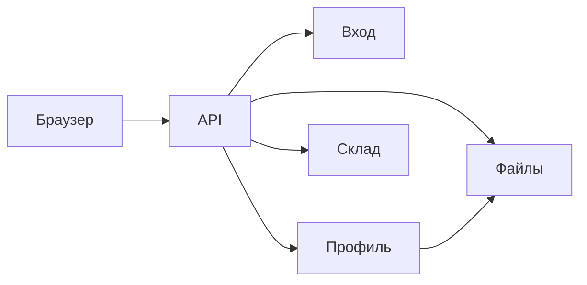
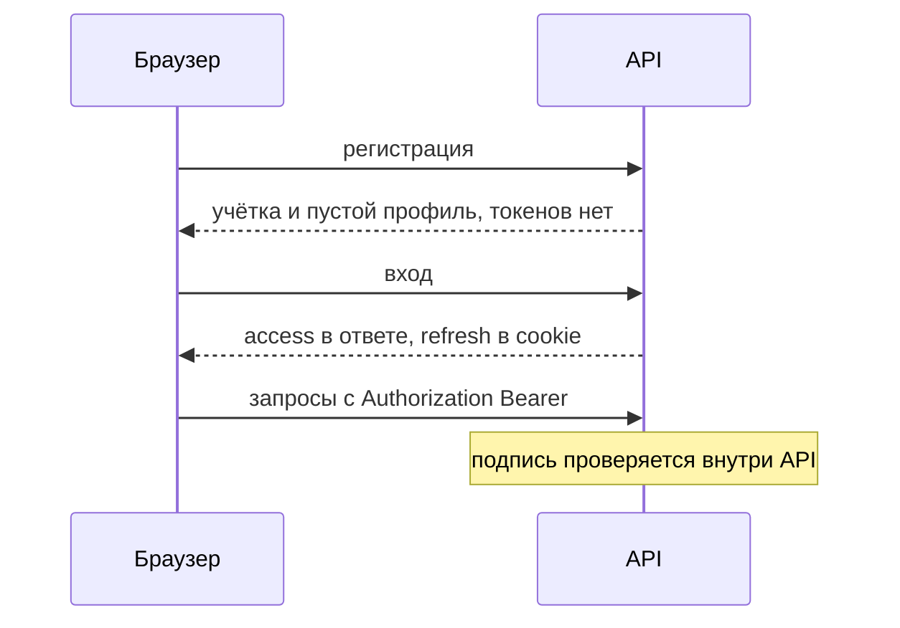
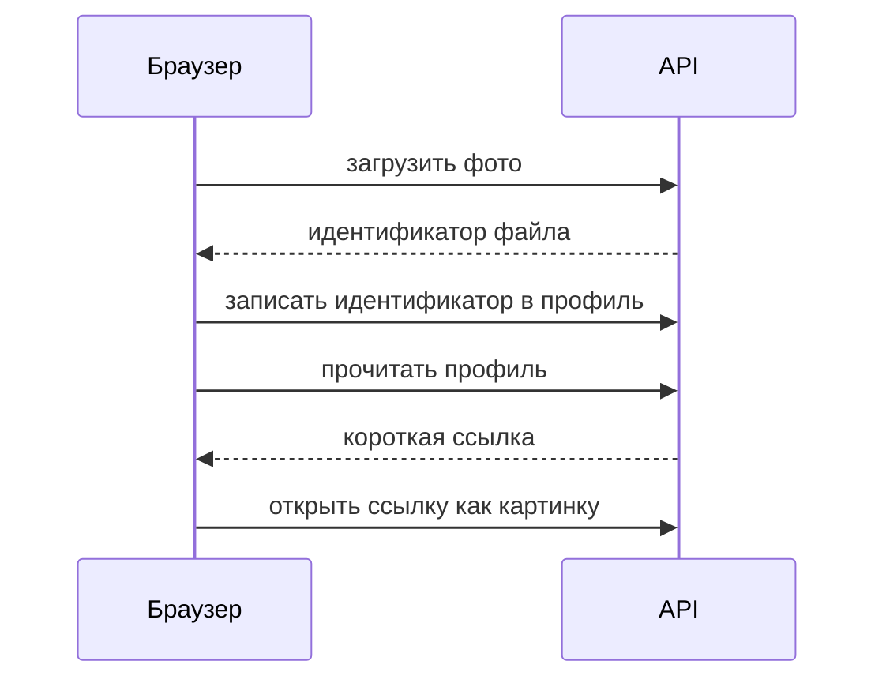
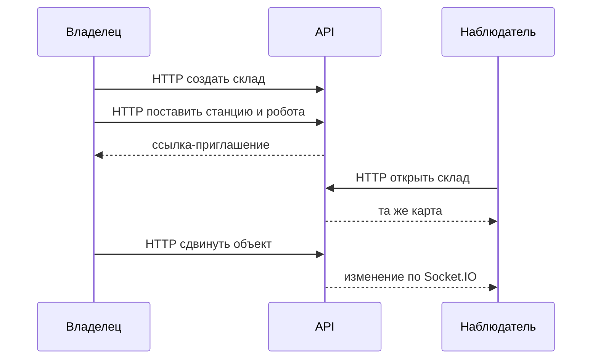

# Как устроено приложение

Одно приложение и одно HTTP API. Браузер разговаривает только с ним. Внутри API модули вызывают друг друга напрямую.

Это картина для команды: схемы и короткие таблицы. Списки ошибок и детали реализации живут в задачах на фичи.

Обмен во время симуляции — [simulation.md](../simulation/simulation.md). Дальше отдельными схемами пойдут помощник ИИ и Telegram. Письмо на почту в эту картину не входит.

| Модуль  | Что хранит                              |
| ------- | --------------------------------------- |
| Вход    | Почта, пароль, сессии                   |
| Профиль | Имя, фамилия, настройки, ссылка на фото |
| Файлы   | Фото профиля. Бакет снаружи не виден    |
| Склад   | Склады, участники, карта                |

## Вход

Пользователь аутентифицируется двумя токенами.

| Токен   | Что это                               | Где у клиента             | Срок                                                   |
| ------- | ------------------------------------- | ------------------------- | ------------------------------------------------------ |
| Access  | JWT, подпись RS256                    | В памяти приложения       | 15 минут                                               |
| Refresh | Случайная непрозрачная строка, не JWT | Только в cookie `refresh` | 7 дней с последнего обновления, не дольше срока сессии |

Сессия живёт 30 дней с момента входа и не продлевается. Новый вход в том же браузере заменяет только сессию этого браузера. Сессии на других устройствах остаются.

Регистрация в том же действии создаёт пустой профиль: пустые имя и фамилия, без фото. Отдельного шага «подождать профиль» нет.

Почту отдаёт вход. Имя, фамилию и фото отдаёт профиль.

## Профиль и фото <Потенциальное расширение>

| Поле          | Что это                                                                              |
| ------------- | ------------------------------------------------------------------------------------ |
| Имя и фамилия | Текст до 100 символов, по умолчанию пустые                                           |
| Настройки     | Пока пустой объект. Ключи появятся, когда их выберут                                 |
| Фото          | Идентификатор файла. В ответе профиля к нему прилагается короткая ссылка на картинку |

Файлы в этой картине — только фото профиля. Слишком большой или неподходящий файл API не принимает. Снятие фото в профиле убирает ссылку. Сам файл удаляется отдельно.

## Склад

|                                          | Владелец | Наблюдатель |
| ---------------------------------------- | -------- | ----------- |
| Смотреть склад и карту                   | да       | да          |
| Менять карту, звать людей, удалять склад | да       | нет         |

Сетка 20 на 20. На карте станции, препятствия и начальные позиции роботов. На одной клетке один объект. Пустые клетки не хранятся. Робот здесь — точка на карте до запуска, не его движение в симуляции.

Один человек владеет не больше чем 10 складами. Склады, куда его пригласили, в этот предел не входят.

Приглашение — ссылка, которую владелец копирует и передаёт сам. Принять её может любой уже вошедший пользователь, после этого он наблюдатель.

Пока склад открыт у нескольких человек, изменения карты приходят остальным по Socket.IO. Команды по-прежнему уходят обычными запросами к API.
