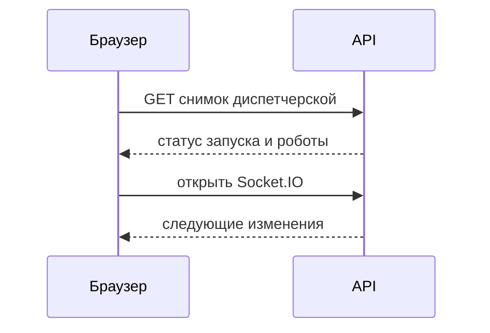
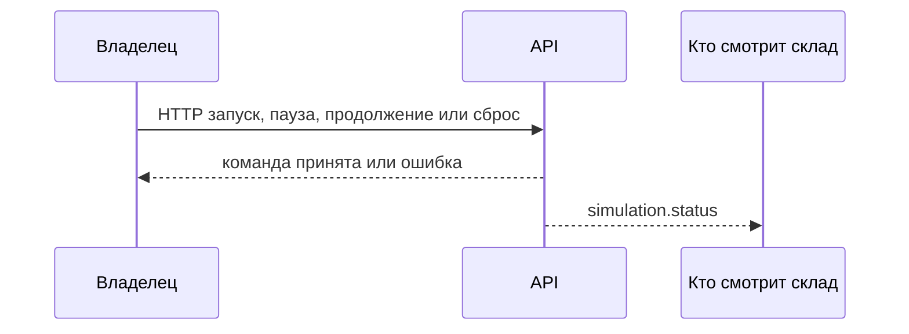
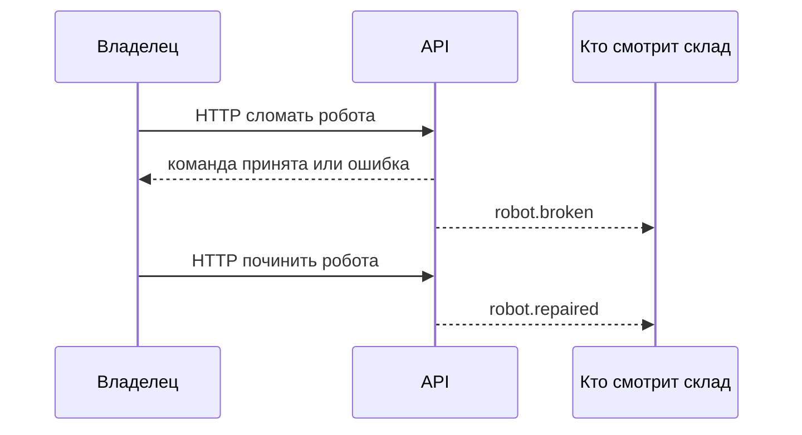
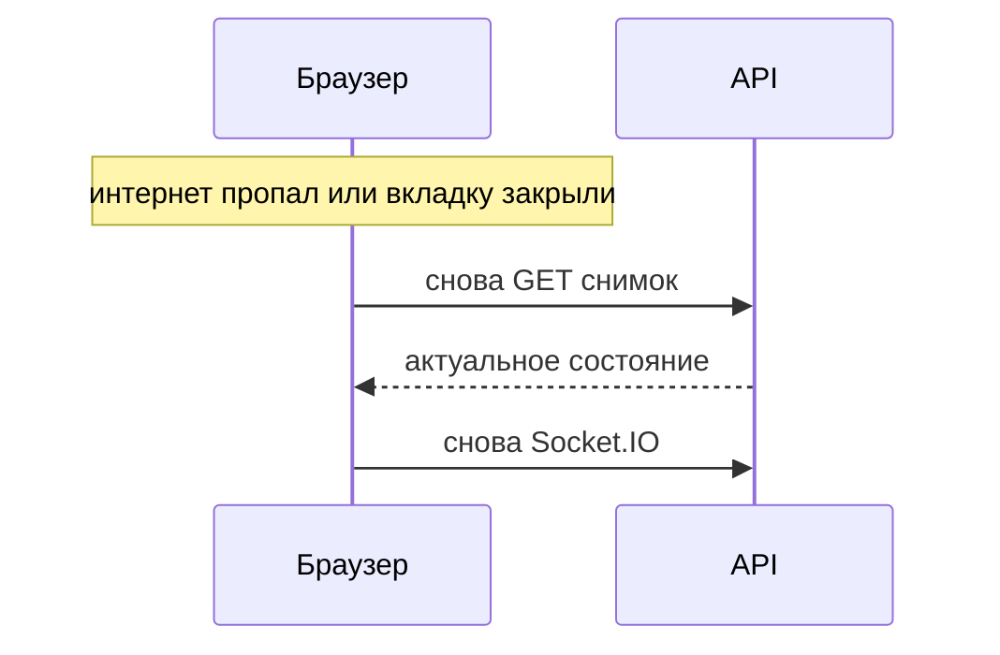

# Обмен во время симуляции

Одно API. Команды и снимок диспетчерской идут по HTTP. Движение роботов и смены статуса приходят по Socket.IO всем, кто сейчас смотрит этот склад, включая автора команды. Наблюдатель те же события получает и команды не отправляет.

Закрытие вкладки запуск не останавливает.

| Что                                          | Куда                  |
| -------------------------------------------- | --------------------- |
| Снимок диспетчерской                         | HTTP                  |
| Запуск, пауза, продолжение, сброс            | HTTP, только владелец |
| Поломка и починка робота                     | HTTP, только владелец |
| Статус запуска, шаг робота, поломка, починка | Socket.IO             |

## Снимок

`GET` диспетчерской отдаёт статус запуска и роботов. Его получают тот, кто открыл диспетчерскую посреди запуска, второй пользователь и тот, кто вернулся после обрыва.

| Статус запуска | Что видит фронт                                    |
| -------------- | -------------------------------------------------- |
| `idle`         | Запуск не идёт                                     |
| `running`      | Роботы двигаются                                   |
| `paused`       | Картинка замерла, запуск жив                       |
| `interrupted`  | Сервер перезапустился, живой запуск не продолжился |

| Состояние робота | Что видит фронт                    |
| ---------------- | ---------------------------------- |
| `free`           | Свободен                           |
| `executing`      | Выполняет задание                  |
| `waiting`        | Ждёт свободный путь                |
| `broken`         | Неисправен и стоит на своей клетке |

```json
{
  "status": "running",
  "robots": [{ "robot_id": "0193a1b2-....", "x": 2, "y": 4, "state": "executing" }]
}
```



Наблюдатель проходит ту же схему и видит тот же снимок.

## Команды владельца

Фронт сначала спрашивает подтверждение у человека, затем отправляет один запрос. Ответ говорит, применилась ли команда. Пока ответа нет, фронт не рисует новое состояние. Ошибка или обрыв запроса показываются на экране, команда не считается выполненной.

Сброс возвращает роботов на начальные клетки карты.



Поломка и починка — отдельные запросы по выбранному роботу. Неисправный робот остаётся на клетке.



## События сокета

`simulation.status` — запуск, пауза, продолжение, сброс или прерывание.

```json
{ "status": "paused" }
```

`robot.moved` — один шаг. Фронт переносит этого робота на новую клетку и ставит состояние из события.

```json
{ "robot_id": "0193a1b2-....", "x": 3, "y": 4, "state": "waiting" }
```

`robot.broken` и `robot.repaired` — тот же робот после команды владельца.

```json
{ "robot_id": "0193a1b2-....", "x": 3, "y": 4, "state": "broken" }
```

## Обрыв связи

Пока сокет молчит, на экране видна потеря соединения. Роботы на экране не додумываются. После восстановления фронт снова берёт снимок и заново слушает сокет.



## Два экземпляра бэкенда

Один склад считает один экземпляр. Остальные экземпляры только доставляют тем же людям те же события и сами роботов не двигают. Два человека на разных экземплярах видят одну и ту же последовательность.

## Рестарт сервера

Живой запуск после рестарта не продолжается. Карта остаётся. В следующем снимке статус `interrupted`.
