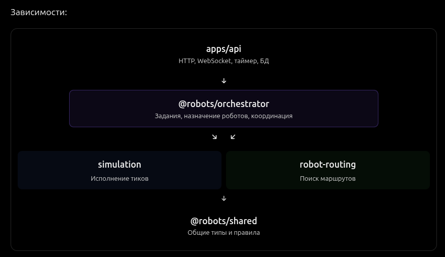

simulation владеет:

- Текущим тиком.
- Картой и состояниями роботов.
- Активными маршрутами.
- Исполнением действий.
- Состоянием неисправностей.
  simulation не владеет:
- Заданиями и их статусами.
- Алгоритмом поиска маршрутов.
- Таблицей резервирований для планирования.
- Назначением заданий роботам.
- Логикой перепланирования.

Границы ответственности

Определяем, чем владеет simulation и что получает извне.

Сейчас

2

Модель состояния

Проектируем SimulationState, RobotState и активные маршруты.

3

Контракты с shared

Проверяем существующие типы и определяем недостающие.

4

Выполнение одного тика

Проектируем step() и синхронное выполнение действий.

5

Применение маршрутов

Определяем атомарное принятие и проверку готовых маршрутов.

6

Команды и поломки

Проектируем applyCommand(), FAULT_ROBOT и RESTORE_ROBOT.

7

События и ошибки

Определяем типизированные результаты операций.

8

Тесты и реализация

Проверяем инварианты и реализуем пакет.

Разделение ответственности

- status — текущее рабочее состояние робота.
- waitingReason — причина ожидания.
- routes — наличие запланированного движения.
- tasks — наличие задания и стадия его выполнения.
